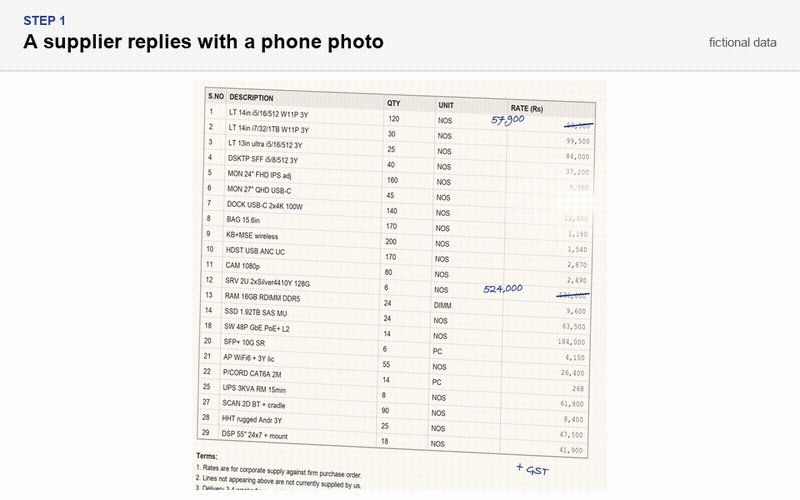

### Human-in-the-loop, for now.

**How I build with AI: the model reads, the code decides.** Models extract, summarise and suggest. Plain, tested code does the counting, the state changes and the final call. Anything the model cannot back with a source gets flagged or dropped, not shipped.

I measured it on six projects: [The model reads, the code decides](ESSAY.md), with the misses as well as the wins.

#### Projects

| Project | Problem | How the AI is fenced in |
|---|---|---|
| [kill-the-quote-spreadsheet](https://github.com/avinashgaurav/kill-the-quote-spreadsheet) | Procurement buyers retype five supplier quotes (Excel, PDF, photos, email) into one comparison sheet | The model reads values; code computes landed cost and cross-checks it. Disputed photo prices are excluded, not averaged. |
| [followthrough](https://github.com/avinashgaurav/followthrough) | Promises made to clients on calls get lost between the call, the ship and telling the client. **In pilot with a sales team (October 2026).** | Every extracted insight must quote the transcript verbatim, or it is rejected. Humans triage before anything goes out. |
| [kokum](https://github.com/avinashgaurav/kokum) | Cooking apps suggest dishes you cannot make with what is in your kitchen | Dish availability is computed in code; the model only ranks and explains, and invented recipe ids are dropped. |
| [ClientLens](https://github.com/avinashgaurav/project-wingman-ClientLens) | Sales reps pitch from memory and misquote the product | A validation pass flags claims it cannot trace to your knowledge base. Flagged claims are removed or the draft is held, and held drafts cannot be written to a doc. |
| [EOD](https://github.com/avinashgaurav/EOD) | Writing the end-of-day update from memory. **In daily use by 5 people across a product and marketing team since mid-2026.** | Local-first. Every README claim is tied to a test, and the build fails if they drift. |

#### Background

- **ZopDev Technologies**, Technical PM (Jul 2025 to now): multi-cloud FinOps platform
- **Jubilant Motorworks**, Associate PM (May 2024 to May 2025): built internal lead and sales tools from zero to one
- PGDM E-Business, Welingkar; B.E. Computer Science, VTU
